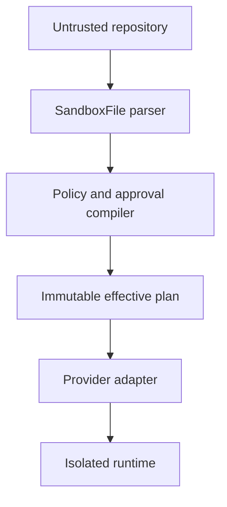

# Security model

## Assets

- repository source and local patches;
- credentials and delegated permissions;
- execution hosts and neighboring workloads;
- produced artifacts and evidence;
- image and source provenance; and
- policy and approval decisions.

## Trust boundaries

The repository, manifest, commands, images, source revisions, and agent output
are untrusted. The policy compiler, credential broker, and provider enforcement
boundary are trusted components of an implementation.

## Required invariants

- Manifests request but never grant authority.
- Credentials remain behind a broker or provider vault.
- Egress defaults to deny.
- Privileged execution and nested container runtimes require explicit policy
  decisions.
- Public ingress and host mounts are not expressible in v1alpha1.
- Host container sockets are never exposed as an implementation of
  `containerRuntime`.
- Unsupported security controls fail closed.
- Mutable image and source references are resolved and pinned before
  production execution.
- Evidence is redacted before persistence.
- Destruction is the default lifecycle outcome.

## Out of scope

This specification does not define a complete sandbox isolation mechanism,
identity provider, secret manager, image-signing system, or policy language.
Conforming implementations must supply those controls and document their threat
model.
